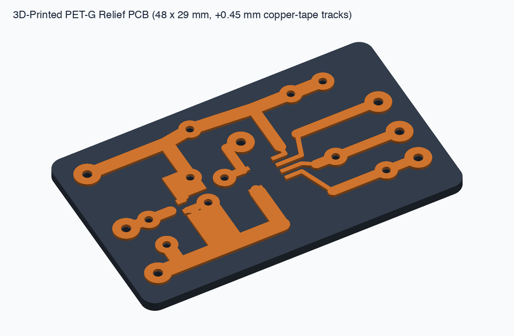
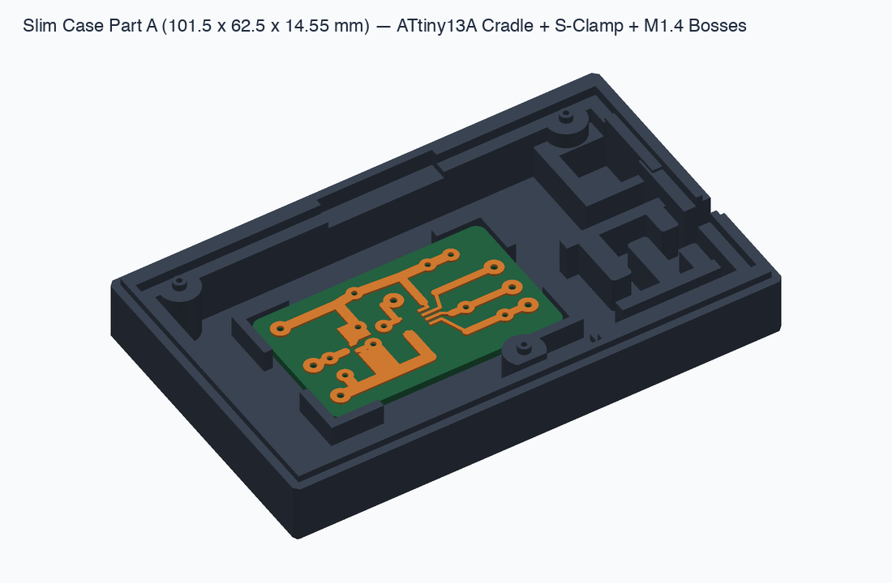
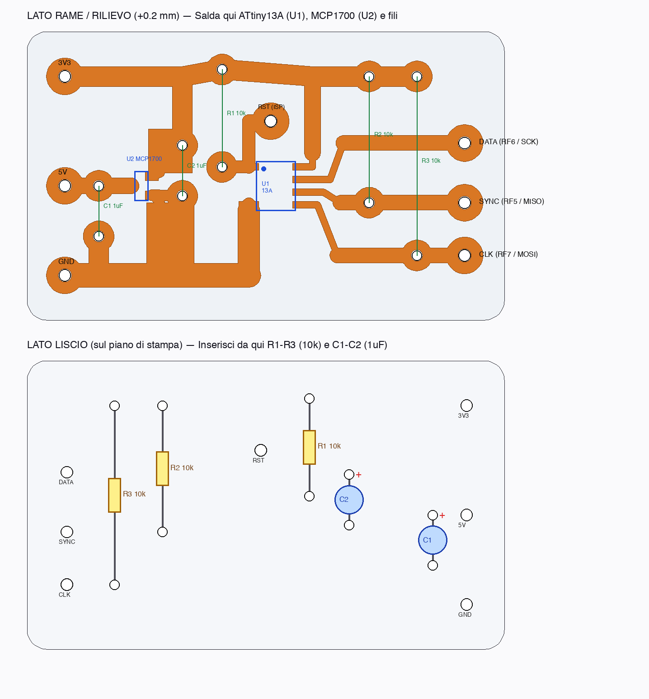

# Xbox 360 RF Module Sync Manager

This Python script enables sync mode on a Xbox 360 FAT RF module using Raspberry Pi GPIO pins (Clock and Data).  
It is based on the original work [archived here](https://web.archive.org/web/20130921051232/http://www.astrorats.org/blog/2013/07/29/xbox-360-rf-module-and-the-raspberry-pi).

## Pinout

### Raspberry Pi → Xbox 360 RF Module
| Raspberry Pi | RF Module Pin | Function |
|--------------|--------------|----------|
| GPIO 24      | Pin 6        | Data     |
| GPIO 25      | Pin 7        | Clock    |
| 3V3          | Pin 1        | VCC      |
| GND          | Pin 4        | GND      |

### USB → Xbox 360 RF Module
| USB Signal | RF Module Pin | Function |
|------------|--------------|----------|
| D-         | Pin 2        | D-       |
| D+         | Pin 3        | D+       |
| GND        | Pin 4        | GND      |

## Standalone Receiver (ATtiny13A + 3D-Printed PET-G PCB + Slim Case)

In [`attiny13-standalone/`](attiny13-standalone/) there is a complete standalone upgrade (no Raspberry Pi needed once built) that uses the RF module's central power button for wireless sync and controller power-off:

| 3D-Printed PET-G Relief PCB (Copper Tape) | Slim Case Part A + PCB Cradle + S-Clamp |
|---|---|
|  |  |

Assembly & wiring layout preview (copper side + through-hole side)

- **3D-printed single-sided PET-G relief PCB (for copper tape):** [`attiny13-standalone/build/x360_rf_attiny13_rilievo.stl`](attiny13-standalone/build/x360_rf_attiny13_rilievo.stl) (`48 × 29 mm`, `ATtiny13A-SSU` + `MCP1700T-3302E/TT` + 3× `10 kΩ` + 2× `1 µF` through-hole, zero jumpers, generated by [`generate_board.py`](attiny13-standalone/generate_board.py)).
- **Upgraded ATtiny13A firmware (v2):** [`attiny13-standalone/firmware/x360_rf_attiny13_v2.hex`](attiny13-standalone/firmware/x360_rf_attiny13_v2.hex) ([source](attiny13-standalone/firmware/x360_rf_attiny13_v2.c)) — combines MicroKnot's Rev. H 10-bit timing & Ring of Light startup/sync animations with agarmash's long-press controller power-off (`1.2 MHz` default fuses, flashable with CH341A + `avrdude`).
- **Slim 3D-printed case remix (~20.1 mm total height):** [`Xbox360_RF_Case_Part_A_ATtiny13_Slim.stl`](attiny13-standalone/build/Xbox360_RF_Case_Part_A_ATtiny13_Slim.stl) + printable LED diffuser ([`Xbox360_RF_Diffuser.stl`](attiny13-standalone/build/Xbox360_RF_Diffuser.stl)) + M1.4 clamping washers ([`Xbox360_RF_Washers_M14.stl`](attiny13-standalone/build/Xbox360_RF_Washers_M14.stl)), with internal PCB cradle and S-shaped USB cable strain relief. Pairs with the original lid (`Part_B`) and button (`Button`) from [MakerWorld #1911648](https://makerworld.com/en/models/1911648-xbox-360-rf-module-box-diy-receiver).
- **Full illustrated step-by-step guide (Italian):** [`attiny13-standalone/GUIDA_STEP_BY_STEP.md`](attiny13-standalone/GUIDA_STEP_BY_STEP.md).

## References
- [Xbox 360 RF Module controlled with Arduino](https://www.electromaker.io/project/view/xbox-360-rf-module-controlled-with-an-arduino-1?srsltid=AfmBOoqaIvXYYNZ5GorwITz8wOPjD5kLdt7DVYkYCu3CwfoVeJucyNF2)  
- [Xbox 360 Controller Receiver Project](https://agarmash.com/posts/xbox-360-controller-receiver/)  
- [Homemade Xbox 360 wireless receiver (Se7enSins forum)](https://www.se7ensins.com/forums/threads/how-to-make-a-homemade-xbox-360-controller-wireless-receiver-for-pc.668839/)
- [DIY Xbox 360 Wireless Receiver](https://microknot.dev/electronics/diy-xbox-360-wireless-receiver)

## Thanks to Dalca
https://www.youtube.com/watch?v=YBUgx-Oq2LY
