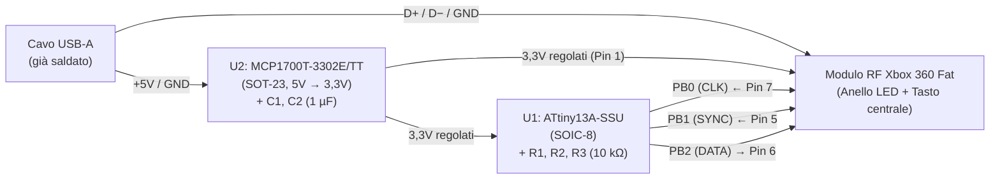
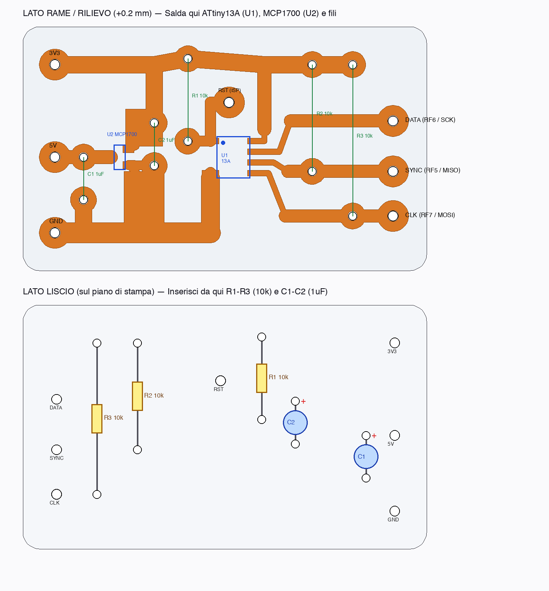
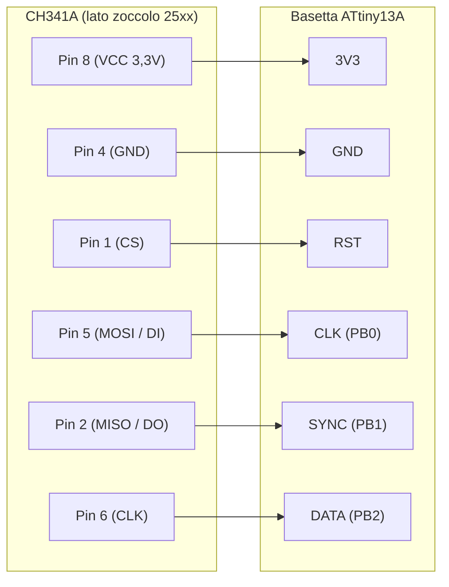
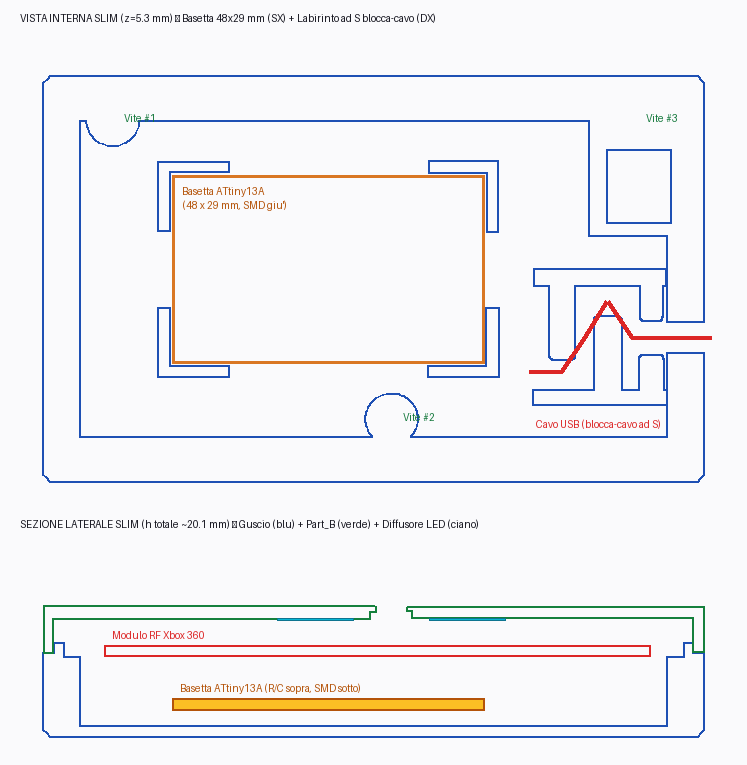

# Guida Step-by-Step — Ricevitore Wireless Xbox 360 Fat (ATtiny13A + Basetta 3D PET-G + Case Slim)

Tutto quello che serve per stampare, saldare, programmare e assemblare il ricevitore in un unico case compatto (~20,1 mm di spessore) con tasto centrale di **Sync** e animazione **Ring of Light**.

---

## Schema a blocchi e collegamenti



---

## Materiale necessario

- **Elettronica:**
  - `U1`: 1× **ATtiny13A-SSU** (SOIC-8)
  - `U2`: 1× **MCP1700T-3302E/TT** (SOT-23-3, regolatore 3,3 V)
  - `R1, R2, R3`: 3× resistenze **10 kΩ** 1/4 W a foro passante
  - `C1, C2`: 2× condensatori **1 µF** a foro passante
  - Nastro adesivo di rame conduttivo, stagno, flussante, cutter affilato
- **Meccanica:**
  - Modulo RF Xbox 360 Fat con cavo USB-A già collegato
  - 3× viti **`2.5 × 1.4 × 6.0`** (oppure `× 8.0`) dal tuo kit viti da occhiali
  - Filamento **PET-G** (per la basetta; per il case va bene PET-G o PLA; per il diffusore LED bianco o trasparente)
- **Programmazione:**
  - Programmatore BIOS **CH341A 24/25** + 6 cavetti DuPont maschio-femmina (o maschio-maschio)

---

## Fase 1 — Stampa 3D su Prusa i3 MK3S+ (nessun supporto)

Tutti i file sono in [build/](build) (tranne i due originali MakerWorld).

| # | File STL | Filamento | Profilo MK3S+ | Impostazioni chiave |
|---|---|---|---|---|
| 1 | [x360_rf_attiny13_rilievo.stl](build/x360_rf_attiny13_rilievo.stl) | **PET-G** | `0.15mm QUALITY` | Faccia liscia sul piano, **Arachne** attivo, **100% infill**, perimetri est. **25–30 mm/s**, **NO ironing**, 235–240 °C |
| 2 | [Xbox360_RF_Case_Part_A_ATtiny13_Slim.stl](build/Xbox360_RF_Case_Part_A_ATtiny13_Slim.stl) | PET-G o PLA | `0.20mm QUALITY` | 20% infill, 3 perimetri, appoggiato sul fondo (`Z = 0`) |
| 3 | [Xbox360_RF_Washers_M14.stl](build/Xbox360_RF_Washers_M14.stl) | PET-G o PLA | `0.15mm` / `0.20mm` | 100% infill (3 rondelline per le viti M1,4) |
| 4 | [Xbox360_RF_Diffuser.stl](build/Xbox360_RF_Diffuser.stl) | **Bianco** o trasparente | `0.15mm QUALITY` | 100% infill (3 strati = `0,45 mm`) |
| 5 | [Xbox360_RF_Case_Part_B.stl](https://makerworld.com/en/models/1911648-xbox-360-rf-module-box-diy-receiver) | PET-G o PLA | `0.20mm QUALITY` | Coperchio originale con archi LED |
| 6 | [Xbox360_RF_Case_Button.stl](https://makerworld.com/en/models/1911648-xbox-360-rf-module-box-diy-receiver) | PET-G o PLA | `0.15mm QUALITY` | Tasto centrale originale |

> [!TIP]
> Prima di stampare la basetta (#1), controlla in anteprima su PrusaSlicer gli **strati 11–13**: i 4 pad a destra dell'ATtiny13A devono risultare ben separati da solchi vuoti (`0,62 mm`).

---

## Fase 2 — Nastro di rame e saldatura della basetta



*(Disegno 1:1 stampabile disponibile anche in [anteprima_rame_1a1.svg](build/anteprima_rame_1a1.svg))*

1. **Foratura:** ripassa i fori della basetta PET-G con punta da **1,0 mm** (R1–R3, C1–C2) e **1,2 mm** (piazzole fili).
2. **Nastro di rame:** stendi il nastro sulla faccia con i rilievi da `+0,45 mm`, premi bene con un'unghia o una tessera di plastica lungo tutti gli spigoli e **incidi i solchi** col cutter seguendo i bordi del rilievo. Rimuovi il rame dai solchi.
3. **Controllo corti col multimetro (beep):** verifica che **nessuna** isola tocchi quelle vicine (soprattutto i 4 pin a destra di `U1` e i 3 pin di `U2`).
4. **Salda gli SMD sul lato rame:**
   - `U1` (**ATtiny13A-SSU**): pallino del **Pin 1 in alto a sinistra** (verso `R1` e la piazzola `RST`). I pin 2 e 3 non hanno rame sotto, quindi zero rischio corti.
   - `U2` (**MCP1700**): pin singolo (**Pin 3 = 5V**) rivolto **a sinistra**; i due pin a destra vanno su `3V3` (sopra) e `GND` (sotto).
5. **Monta i componenti a foro passante dal lato liscio:**
   - Inserisci `R1, R2, R3` (`10 kΩ`) e `C1, C2` (`1 µF`, **polo `+` verso l'alto** come nell'immagine sotto!).
   - **Importante per lo spessore Slim:** piega i due condensatori `C1` e `C2` **sdraiati contro la basetta** così sporgono al massimo `4,5–5 mm`!
   - Salda i reofori sul lato rame e taglia le eccedenze **ben raso** (perché il lato rame/SMD guarderà verso il fondo del case).

---

## Fase 3 — Programmazione ATtiny13A con CH341A 24/25

> [!WARNING]
> **NON** inserire l'ATtiny13A nello zoccolo 25xx del CH341A e **NON** usare la pinza SOIC-8 diretta da BIOS: i pin 2, 6 e 7 sono scambiati! E programma la basetta **PRIMA** di collegare il modulo RF Xbox 360.



1. Collega i 6 cavetti DuPont dallo zoccolo **25xx** del CH341A alle 6 piazzole della basetta (lascia scollegata `5V`).
2. Se non hai `avrdude`, installalo su macOS con `brew install avrdude`.
3. Testa il riconoscimento del chip e poi scrivi il **firmware v2** ([x360_rf_attiny13_v2.hex](firmware/x360_rf_attiny13_v2.hex)) — i fuse di fabbrica dell'ATtiny13A (`1,2 MHz`) vanno già bene:

```bash
# 1. Test connessione (deve riconoscere ATtiny13 / signature 0x1e9007)
avrdude -c ch341a -p t13

# 2. Scrittura firmware v2 (animazione anello + fix Rev. H + spegnimento controller)
avrdude -c ch341a -p t13 -U flash:w:firmware/x360_rf_attiny13_v2.hex:i
```

---

## Fase 4 — Collegamento al modulo RF e assemblaggio nel Case Slim



### 1. Salda i fili tra basetta, cavo USB e modulo RF

| Piazzola basetta | Dove va | Note |
|---|---|---|
| `5V` | Filo rosso **+5 V** del cavo USB | Alimenta l'MCP1700 (rimuovi eventuali vecchi diodi in serie sul +5 V!) |
| `GND` | Filo nero **GND** del cavo USB + **Pin 4/8/9** modulo RF | Massa comune |
| `3V3` | **Pin 1** del modulo RF | Porta i 3,3 V stabilizzati dall'MCP1700 al modulo RF |
| `SYNC` | **Pin 5** del modulo RF | Tasto centrale del modulo RF |
| `DATA` | **Pin 6** del modulo RF | Linea dati |
| `CLK` | **Pin 7** del modulo RF | Linea clock |
| `RST` | *(lasciare scollegata)* | Usata solo per ISP |

*(I fili **D−** e **D+** del cavo USB restano saldati direttamente sui **Pin 2** e **Pin 3** del modulo RF come li hai già adesso.)*

### 2. Assemblaggio meccanico nel Case Slim

1. **Basetta nel fondo:** appoggia la basetta nella culla di `Part_A_ATtiny13_Slim` con il **lato rame/SMD rivolto verso il basso** e il **lato resistenze/condensatori verso l'alto**.
2. **Blocco cavo USB ad S:** infila il cavo USB dall'alto nella fessura a U destra e schiaccialo dentro il **labirinto ad S** prima di montare il modulo RF.
3. **Fissaggio modulo RF:** appoggia il modulo RF sui **3 collarini di centraggio**, metti sopra le **3 rondelline stampate** (`Xbox360_RF_Washers_M14`) e avvita 3 viti **`2.5 × 1.4 × 6.0`** (o `× 8.0`) del tuo kit nei fori pilota da `1,15 mm`.
4. **Diffusore LED e tasto:** fissa l'anello [Xbox360_RF_Diffuser.stl](build/Xbox360_RF_Diffuser.stl) con un velo di colla o biadesivo sotto il coperchio `Part_B` (centrato sugli archi LED), inserisci il tasto `Button` nel foro centrale di `Part_B` e chiudi il coperchio a scatto su `Part_A_Slim`.

---

## Fase 5 — Test e utilizzo

1. **Collega alla porta USB del PC:** dopo `2,5 s` il modulo RF esegue la **classica animazione verde rotante** dell'anello Xbox 360 e lascia acceso il LED centrale verde.
2. **Pressione breve (< 1 s) del tasto centrale:** avvia la ricerca/Sync (l'anello verde ruota 3 volte) → premi il tasto Sync sul controller Xbox 360 per abbinarlo.
3. **Pressione lunga (≥ 1 s) del tasto centrale:** fa lampeggiare l'anello e **spegne tutti i controller connessi**.
4. **Driver su Windows 11** *(su Linux / RetroPie è già plug-and-play)*:
   - *Gestione dispositivi* → tasto destro sul dispositivo sconosciuto → **Aggiorna driver** → **Cerca driver nel computer** → **Scegli da un elenco** → **Periferiche Xbox 360** → **Xbox 360 Wireless Receiver for Windows**.
